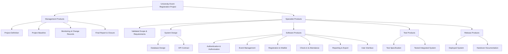
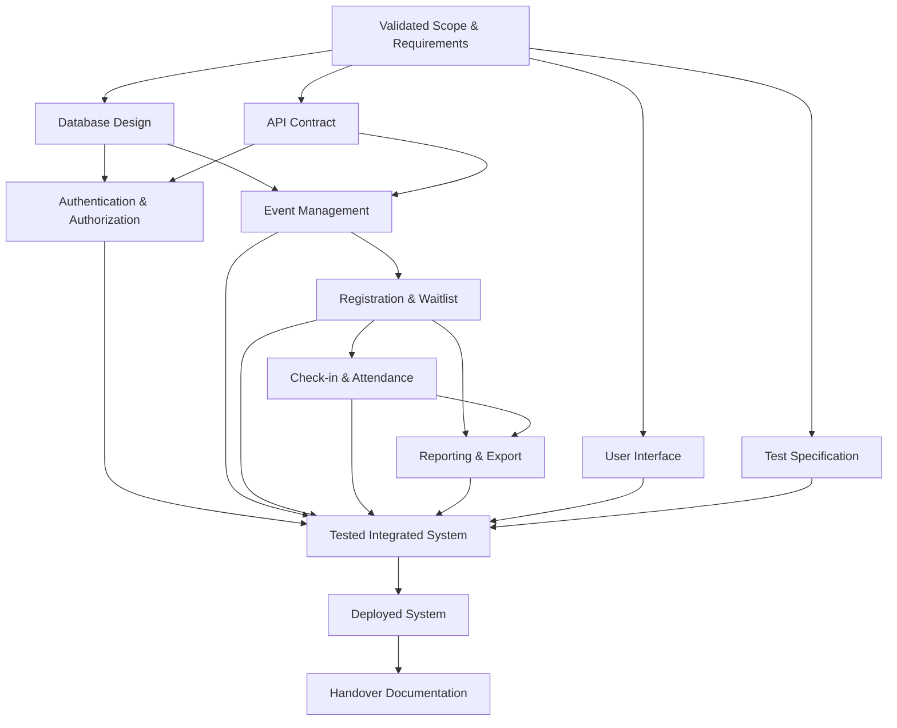

# 2.1 & 2.3 Product Breakdown Structure và Product Flow Diagram

> Thay khung cũ (mã P0–P4) bằng nội dung A15 (`../../../A15_PBS_PFD.md`, nhập nguyên văn). Bảng đối chiếu mã cũ ở cuối file, dùng cho tài liệu còn ghi mã P.

## 1. Product Breakdown Structure (PBS)

---

## 2. Product instances

| Generic product | Instances |
|---|---|
| Software Product | Authentication & Authorization |
| Software Product | Event Management |
| Software Product | Registration & Waitlist |
| Software Product | Check-in & Attendance |
| Software Product | Reporting & Export |
| Software Product | User Interface |

Core product chain:

`Event Management → Registration & Waitlist → Check-in & Attendance → Reporting & Export`

---

## 3. Product Flow Diagram (PFD)

---

## 4. A15 acceptance check

- [x] PBS có cả management và specialist products.
- [x] Product được phân biệt với activity/event/resource.
- [x] Generic software products đã được instantiate.
- [x] PFD mô tả product dependency, không phải task schedule.
- [x] Core scope được bao phủ và không đưa feature ngoài scope vào.
- [x] Mỗi leaf product có thể map sang activity ở A17.

---

## 5. Chốt A15

A15 hoàn thành với hai artifact chính:

1. **PBS** – xác định dự án phải tạo ra những product nào.
2. **PFD** – xác định quan hệ derivation/dependency giữa các product.

Product Description thuộc A16; Activity Network thuộc A17.

---

## 6. Đối chiếu mã cũ (P) sang mã chính thức (M/S)

| Mã cũ | Tên cũ | Mã chính thức |
|---|---|---|
| P1.1 | Project definition | M1 Project Definition |
| P1.2 | Project Baseline V1.0 | M2 Project Baseline |
| P1.3, P1.4, P1.5 | Weekly logs, risk register, change request & Baseline V2.0 | M3 Monitoring & Change Records |
| P1.6 | Final report | M4 Final Report & Closure |
| P2.1 | Requirements specification | S1 Validated Scope & Requirements |
| P2.2 | Database design | S21 Database Design |
| P2.3 | API contract | S22 API Contract |
| P3.1 | Authentication & roles | S31 Authentication & Authorization |
| P3.2 | Event management | S32 Event Management |
| P3.3 | Registration | S33 Registration & Waitlist |
| P3.4 | Check-in & attendance | S34 Check-in & Attendance |
| P3.5 | Reporting & export | S35 Reporting & Export |
| P3.6 | Deployed system | S51 Deployed System |
| P4.1 | Test plan & test cases | S41 Test Specification |
| P4.2 | Test results & build evidence | S42 Tested Integrated System |
| P4.3 | UAT record | không có mã riêng; biên bản UAT thuộc CP5 (M3) |
| — | — | S36 User Interface, S52 Handover Documentation (mới trong A15) |
