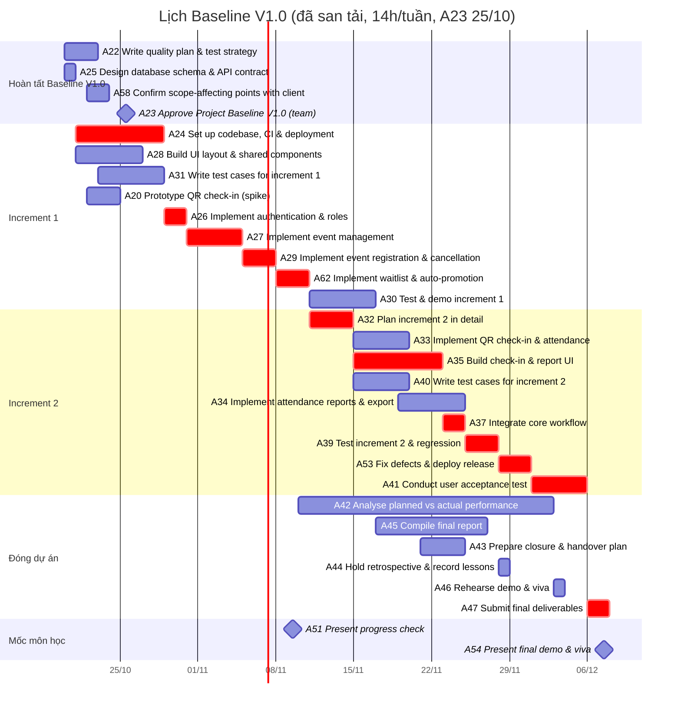

**Ghi chú thay đổi so với bản 0.2 (21/10):** TV1 chốt họp A23 ngày 25/10 (họp định kỳ 15h Chủ nhật) thay cho 28/10. Chạy lại bằng `baseline-v1-a23-25-10.json` (bản 0.2 dùng `baseline-v1.json`, giữ nguyên): A21, A50 đã xong 20–21/10 (TV1 báo); A58 và A20 không bắt đầu trước 22/10; A23 cố định 25/10. **Ngày san tải từ A24 trở đi không đổi**; chỉ A20 (22–24/10), A58 (22–23/10), A23 (25/10), A36/A57 (từ 25/10) đổi; float CPM tăng 1 ngày. Tổng effort chốt 364,2h (PM chọn 21/10, xem `2.6-estimates.md`).

**Ghi chú thay đổi so với bản 0.1:** thay toàn bộ nội dung khung bằng lịch tính lại ngày 20/10 theo estimate PM chốt 20/10, mạng L1–L7 và các quyết định L8–L11 ở mục "Quyết định lập lịch". Bản 0.1 trỏ tới `../plan/index.html` nhưng thư mục này không có trong repo; nguồn hiện tại là tab 10, 11 của Sheet master.

# 2.11 Lịch dự án và cost baseline

## Nguồn và cách tính

- **Effort:** cột E tab 10, bản lưu 23:46 ngày 20/10 (= PERT tab 11, PM chốt 20/10). A25 chỉ còn 1h TV3 xác nhận PD-02; các activity đã xong (A01–A19, A21, A50) không lập lịch lại.
- **Phụ thuộc:** tab 10 cột G, sửa theo L8–L11 bên dưới. Quan hệ finish-to-start.
- **Năng lực:** 14h/tuần mỗi người, cả 5 thành viên (TV1 chốt 20/10, theo báo cáo của nhóm: 14–16h/tuần); rải đều 7 ngày, khoảng 2h/ngày. A36, A57 là hammock của TV1 (35,1h) trừ đều vào năng lực TV1 từ sau A23 đến 07/12, khoảng 0,95h/ngày.
- **Thời lượng:** ngày lịch = làm tròn lên (phần effort lớn nhất của một owner / giờ rảnh mỗi ngày của người đó). Effort activity nhiều owner chia đều, trừ các activity ghi rõ số giờ ở cột Owner. Các cuộc họp (A23, A44, A46, A51, A54) diễn ra trọn trong một ngày.
- **CPM:** forward/backward pass, A23 cố định 25/10, A51 cố định 09/11, A54 cố định 07/12; A20, A58 không bắt đầu trước 22/10 (`not_before`). **Float âm** nghĩa là trễ so với mốc cố định.
- **San tải (A50):** xếp lịch theo từng ngày, mỗi người tối đa 2h/ngày, activity có LS nhỏ hơn được làm trước. Cột "Bắt đầu/Kết thúc" là kết quả san tải; tải theo tuần ở `2.10-resource-plan.md`.
- **Script:** `../../tools/schedule/` (cách chạy trong README ở đó).
- **Dữ liệu dán Sheet:** `../sheet-import/10-activity-A23-25-10.tsv` (thay `10-activity-A21.tsv` đã dán 21/10; dán đè cột A–P các dòng có trong file; dòng A21, A50 giữ nguyên). Cột A–P khớp bố cục tab 10, chỉ gồm các activity chưa xong cùng A36, A38, A57; cột cuối ghi những cột đã đổi.

## Quyết định lập lịch (20/10)

PM (TV1) chọn ngày 20/10 trong các phương án do AI đề xuất (AI Log 20/10). Nhóm xác nhận tại A23 ngày 25/10.

| Mã | Quyết định | Lý do |
|---|---|---|
| L8 | Làm gối đầu Increment 1: A24, A28, A31 bắt đầu sau A25; A26 sau A24; A27 chờ A23 (thêm A23 → A27, bỏ A23 → A26, A28, A31) | CP2 18/10 đã duyệt scope; điều kiện còn lại chỉ là lịch và tài nguyên |
| L9 | TV1 giữ vai trò owner và người duyệt, TV2 thực hiện thay khoảng 19h: A22 (6h), A43 (5,2h), phần kiểm thử/chất lượng trong A45 (5h) và A42 (3h). A34 làm chung TV3, TV5. A39 làm chung TV2, TV4 | Trước khi chuyển, TV1 cần khoảng 118h trên khoảng 96h có sẵn từ 20/10 đến 06/12 |
| L10 | Việc đóng dự án bắt đầu sớm: A43, A45 sau A30; A42 sau A51; A44 sau A39; A46 sau A45, A42, A43, A44 (song song A53, A41); A47 sau A41, A45, A42, A43, A44; A54 sau A46, A47 | Chuỗi A42 → A45 → A46 → A47 sau UAT chỉ một người làm, mất khoảng 4 tuần |
| L11 | A32 sau A62, làm song song A30 | A32 nằm trên đường găng |
| — | **Giữ REQ-21** (sửa/hủy sự kiện sau công bố, Should), không cắt | Bảng estimate chưa tách Should/Could. Chỉ REQ-21 có giờ tính được (khoảng 8h trong A27, ước suy theo phân rã TV3) và chỉ rút được 1–2 ngày. REQ-16 đến REQ-20 không nằm trong activity nào, 0h |
| — | A51 cố định 09/11. Giữ cạnh A37 → A51; A39 thêm A37 làm đầu vào trực tiếp | TV1 sẽ hỏi thầy phạm vi tối thiểu tại Progress Check (A58) |
| — | **A23 họp ngày 25/10** (TV1 chốt 21/10), gửi A58 từ 22/10 | Dùng họp định kỳ Chủ nhật; A21, A50 đã xong sớm. A23 không nằm trên đường găng nên không rút được ngày demo. Nếu thầy chưa trả lời A58 trước 25/10, CP4 ghi assumption còn mở |

## Mốc chính

| Mốc | Activity | Ngày theo lịch | Mục tiêu | Loại | Chênh lệch |
|---|---|---|---|---|---|
| Chốt Baseline V1.0 (hoàn tất CP2) | A23 | 25/10 | 23/10 (hạn điều kiện CP2) | nội bộ | trễ 2 ngày |
| Xong Increment 1 (CP3) | A30 | 11–16/11 | 01/11 | nội bộ | trễ 15 ngày |
| Progress Check (CP4) | A51 | 09/11 | 09/11 | cố định | xem dưới |
| Luồng chính có QR (A37) | A37 | 23–24/11 | trước 09/11 theo tiêu chí CP4 trong 2.5 | | trễ 16 ngày |
| UAT (CP5) | A41 | 01–05/12 | 23–24/11 | nội bộ | trễ 11 ngày |
| Nộp bài | A47 | 06–07/12 | trước 07/12 | | 0 ngày dự trữ |
| Final demo & viva | A54 | 07/12 | 07/12 | cố định | 0 ngày dự trữ |

**Tại Progress Check 09/11, lịch có:** A27, A29 xong; A62 đang làm (08–10/11); A20 spike QR xong; chưa có QR check-in (A33 bắt đầu 15/11). Tiêu chí CP4 trong 2.5 ("core workflow đến QR check-in có manual fallback") **không đạt** theo lịch này; TV1 hỏi thầy phạm vi tối thiểu (A58) rồi cập nhật 2.5.

## Critical path

- **Theo CPM (không giới hạn tài nguyên):** chuỗi A25 → A28 → A27 → A29 → A62 → A32 → A35 → A37 → A51 có float −12 ngày, nghĩa là A37 không kịp Progress Check. Chuỗi sau A37 (A39 → A53 → A41 → A47) có float +5 ngày so với 07/12.
- **Sau san tải:** A24 → A26 → A27 → A29 → A62 → A32 → A35 → A37 → A39 → A53 → A41 → A47 → A54. A24 kéo dài 21–28/10 vì TV4 làm song song A28. A35 (TV4, 14,8h, 8 ngày) quyết định ngày bắt đầu A37. **Không còn ngày dự trữ trước 07/12.**
- A23 không nằm trên đường găng sau san tải: A27 chờ A26 (30/10), muộn hơn A23 (25/10).

## Lịch chi tiết (sau san tải)

Cột "Thời lượng" là thời lượng CPM; "Bắt đầu/Kết thúc" là sau san tải. Effort A25 là phần còn lại.

| ID | Activity | Owner | Effort (h) | Thời lượng CPM (ngày) | Bắt đầu | Kết thúc | Float CPM (ngày) |
|---|---|---|---:|---:|---|---|---:|
| A21 | Draft schedule & Gantt | TV1 | 5.2 | | 20/10 | 21/10 | đã xong |
| A50 | Allocate resources & level schedule | TV1 | 6.3 | | 20/10 | 21/10 | đã xong |
| A22 | Write quality plan & test strategy | TV1 duyệt; TV2 thực hiện (từ 20/10; trước đó TV2, TV4) | 6.0 | 3 | 20/10 | 22/10 | 2 |
| A25 | Design database schema & API contract | TV3, TV5; TV4 review | 1.0 | 1 | 20/10 | 20/10 | -12 |
| A24 | Set up codebase, CI & deployment | TV5, TV4 | 8.9 | 3 | 21/10 | 28/10 | -11 |
| A28 | Build UI layout & shared components | TV4 | 10.5 | 6 | 21/10 | 26/10 | -12 |
| A20 | Prototype QR check-in (spike) | TV3, TV5 | 5.7 | 2 | 22/10 | 24/10 | 9 |
| A58 | Confirm scope-affecting points with client | TV1 | 2.1 | 2 | 22/10 | 23/10 | 1 |
| A31 | Write test cases for increment 1 | TV2 | 10.5 | 6 | 23/10 | 28/10 | 27 |
| A23 | Approve Project Baseline V1.0 (team) | Cả nhóm | 5.2 | 1 | 25/10 | 25/10 | 0 |
| A26 | Implement authentication & roles | TV3, TV5, TV4 | 10.5 | 2 | 29/10 | 30/10 | -11 |
| A27 | Implement event management | TV3, TV5, TV4 | 25.3 | 5 | 31/10 | 04/11 | -12 |
| A29 | Implement event registration & cancellation | TV3, TV5, TV4 | 12.6 | 3 | 05/11 | 07/11 | -12 |
| A62 | Implement waitlist & auto-promotion | TV3, TV5, TV4 | 13.4 | 3 | 08/11 | 10/11 | -12 |
| A51 | Present progress check | Cả nhóm (TV1 chủ trì) | 5.2 | 1 | 09/11 | 09/11 | 0 |
| A42 | Analyse planned vs actual performance | TV1; TV2 làm phần chất lượng, kiểm thử (3h) | 10.3 | 7 | 10/11 | 02/12 | 18 |
| A30 | Test & demo increment 1 | TV2 chủ trì, cả nhóm | 10.5 | 2 | 11/11 | 16/11 | 16 |
| A32 | Plan increment 2 in detail | TV1 | 4.1 | 4 | 11/11 | 14/11 | -12 |
| A33 | Implement QR check-in & attendance | TV5, TV3 | 17.8 | 5 | 15/11 | 19/11 | -9 |
| A35 | Build check-in & report UI | TV4 | 14.8 | 8 | 15/11 | 22/11 | -12 |
| A40 | Write test cases for increment 2 | TV2 | 8.4 | 5 | 15/11 | 19/11 | 10 |
| A45 | Compile final report | TV1; TV2 viết phần kiểm thử, chất lượng (5h) | 15.5 | 10 | 17/11 | 26/11 | 16 |
| A34 | Implement attendance reports & export | TV3, TV5 | 14.8 | 4 | 19/11 | 24/11 | 11 |
| A43 | Prepare closure & handover plan | TV1 duyệt; TV2 thực hiện | 5.2 | 3 | 21/11 | 24/11 | 23 |
| A37 | Integrate core workflow | TV3, TV5, TV4 | 8.4 | 2 | 23/11 | 24/11 | -12 |
| A39 | Test increment 2 & regression | TV2, TV4 | 10.5 | 3 | 25/11 | 27/11 | 5 |
| A44 | Hold retrospective & record lessons | Cả nhóm | 5.2 | 1 | 28/11 | 28/11 | 10 |
| A53 | Fix defects & deploy release | TV3, TV5, TV4 | 12.6 | 3 | 28/11 | 30/11 | 5 |
| A41 | Conduct user acceptance test | TV2, TV1 | 6.3 | 3 | 01/12 | 05/12 | 5 |
| A46 | Rehearse demo & viva | Cả nhóm | 10.3 | 1 | 03/12 | 03/12 | 11 |
| A47 | Submit final deliverables | TV1 | 2.1 | 2 | 06/12 | 07/12 | 5 |
| A54 | Present final demo & viva | Cả nhóm | 5.2 | 1 | 07/12 | 07/12 | 0 |
| A36 | Monitor progress & update logs (hammock) | TV1 | 24.8 | | 25/10 | 07/12 | |
| A57 | Chair traceability & consistency reviews (hammock) | TV1 | 10.3 | | 25/10 | 07/12 | |
| A38 | Hold contingency buffer (change event) | TV1 (quản lý quỹ) | 30 | | ngoài chuỗi | | |

## Gantt

Tô đỏ (`crit`) là đường găng sau san tải.

## Cost baseline

Đơn vị person-hours, không quy VND (E04). Effort lấy theo tab 10/11 (PM chốt 20/10). Các activity làm trước khi ước lượng (A01–A15, A49, A55, A59, A61) không có estimate, chỉ ghi actual ở tab 3 (đang thu theo I02).

| Giai đoạn | Activity | Effort (person-hours) |
|---|---|---:|
| Lập kế hoạch Task 2 | A16, A17, A18, A19, A22, A25, A21, A20, A50, A58, A23 | 70.2 |
| Increment 1 | A24, A26, A28, A31, A27, A29, A62, A30 | 102.2 |
| Increment 2 và kiểm thử | A32, A33, A34, A35, A40, A37, A51, A39, A53, A41 | 102.9 |
| Đóng dự án | A42, A43, A44, A45, A46, A47, A54 | 53.8 |
| Quản lý xuyên suốt | A36, A57 | 35.1 |
| **Cộng effort kế hoạch** | | **364.2** |
| Quỹ dự phòng A38 (change event, tách riêng) | A38 | 30.0 |
| **Cost baseline** | | **394.2** |

A38 không có ngày trong lịch. Giờ dư của TV2–TV5 từ 20/10 đến 06/12 (xem 2.10) đủ chứa 30h, nhưng **lịch không còn ngày dự trữ**: nếu change event rơi vào chuỗi găng thì phải cắt Could rồi Should hoặc lập Baseline V2.0.

## Rủi ro và việc cần làm tiếp

- **R15 (lịch vượt mốc):** lịch chỉ vừa kịp 07/12, CP3, CP4, CP5 đều trễ so với kế hoạch ban đầu. TV1 đã cập nhật R15 và Risk History (21/10, TV1 báo).
- TV1 khoảng 15–16h ở tuần 14–15 (xem 2.10), trong mức 14–16h/tuần; TV1 quyết không san tải thêm (21/10).
- 2.5 v0.5 (21/10) đã ghi ngày mới của CP3, CP5 và deviation; CP4 chờ kết quả A58 (email v0.3, gửi từ 22/10).
- Lịch thi và ngày bận đã nằm trong mức 14–16h/tuần (TV1 xác nhận 21/10, xem 2.10).
