**Ghi chú thay đổi so với bản 0.9 (20/10, A21):**

- Thêm L8–L11 (TV1 chọn 20/10 khi chạy CPM và san tải ở A21/A50, chi tiết ở `2.11-schedule.md`): A24, A28, A31 sau A25 và A26 sau A24 (bỏ A23 → A26, A28, A31), thêm A23 → A27; A32 sau A62; A42 sau A51; A43, A45 sau A30; A44 sau A39; A46 sau A45, A42, A43, A44; A47 sau A41, A45, A42, A43, A44; A54 sau A46, A47; A39 thêm A37. Giữ A37 → A51; A51 cố định 09/11.
- Mục "Nguồn dữ liệu": thư mục `../plan/` không có trong repo; nguồn hiện tại là tab 10, 11 Sheet master.

**Ghi chú thay đổi so với bản 0.8 (20/10):**

- Ghi nhận nhóm duyệt toàn bộ L1–L7 tại CP2 ngày 18/10; gỡ các nhãn "chờ nhóm duyệt". Stack chốt 18/10: React, Go, PostgreSQL. Không đổi phụ thuộc, effort hay thời lượng.
- Chuyển bản này vào repo (`docs/task2/`), thay bản 0.5.

**Ghi chú thay đổi so với bản 0.7 (15/10):**

- Thêm L7 (PM chốt 15/10): bỏ cạnh A20 → A24, thêm A25 → A24 và A20 → A33. Chỉ đổi các cạnh này, không đổi effort, thời lượng hay L1–L6. TV2 cần xem lại phần này vì đã duyệt v0.7.

**Ghi chú thay đổi so với bản 0.5:**

- Giữ nguyên các phụ thuộc trong sơ đồ và quyết định L1–L6 của TV1; làm rõ số effort, thời lượng, float và đường găng còn chờ A18/A21/A50. Bỏ tô đỏ các nút chưa được xác nhận là găng và sửa nhận định A31 găng do kết thúc cùng A29.
- Sửa trạng thái đồng bộ nguồn: Sheet master đã có A62 và tên mới A53, nhưng HTML đang có vẫn là bản cũ; chưa xác nhận đã cập nhật Jira. Ghi rõ chưa có PFD gốc trong thư mục để đối chiếu trực tiếp.
- Sửa ánh xạ đầu ra: scope tiếp tục được cập nhật ở A12/A58; A38 là quỹ dự phòng, change record chỉ được tạo khi có thay đổi thực tế.
- Phân biệt mốc môn học với mốc nội bộ; làm rõ A58 là bước rà và hỏi các điểm ảnh hưởng lớn còn mở theo P05, việc gửi email do TV1 quyết định.
- Rà lần hai ngày 14/10 (bản 0.7): tách A14 khỏi nhóm việc được ghi đã thực hiện vì chưa đủ biên bản CP1; đồng bộ điều kiện CP2 với file 2.5: đủ đầu vào và lịch khả thi, không chỉ A21 hoàn thành.

# 2.4 & 2.7 Activity network

> **Trạng thái:** TV2 duyệt nội dung network ngày 14/10; nhóm duyệt L1–L7 tại CP2 ngày 18/10 (đạt có điều kiện). Bản gốc do TV1 chuẩn bị với hỗ trợ AI. TV3 xác nhận A34 gối đầu A33 khả thi ngày 14/10. Effort lấy theo tab Estimation (PM chốt giữ số hiện tại ngày 20/10); ES/EF, float và đường găng chờ A21/A50, hạn hoàn tất điều kiện CP2 là 23/10.

## Nguồn dữ liệu

> **Cập nhật 20/10:** thư mục `../plan/` không có trong repo. Danh sách activity, phụ thuộc và effort lấy từ tab 10, 11 Sheet master; ES/EF/LS/LF, float, đường găng và Gantt tính lại ở `2.11-schedule.md` (A21), san tải ở `2.10-resource-plan.md` (A50).

Danh sách activity, dependencies, effort và thời lượng nằm trong `../plan/index.html`, mảng `ACT`.
Trang này tự tính forward/backward pass, ES/EF/LS/LF, float và critical path, rồi vẽ Gantt.

Đối chiếu ngày 14/10 sử dụng `phan-cong-task2.md`, `xac-nhan-sheet-theo-thanh-vien.md`, Client Log và các tab Activity/Traceability trong Sheet master. Bản `CO3011_Event_Registration_Plan.html` hiện có chưa đồng bộ L1–L6. Phần quan hệ PFD dưới đây được giữ theo bản TV1 (`../../../A15_PBS_PFD.md`).

**Không chép bảng activity sang file này.** Sau khi đồng bộ L1–L6 và tính lại lịch, export từ trang plan (nút Copy ở mục "Bảng phân tích mạng") khi cần đưa vào báo cáo.

## Quy ước

- Tên activity: động từ + danh từ (`Implement event management`, không phải `Event management`).
- Mỗi activity tạo ra ít nhất một product trong PBS.
- Quan hệ: finish-to-start. Việc A34 gối đầu A33 (L1 = C) được mô hình hóa bằng cách A34 phụ thuộc A32 và A25, không dùng start-to-start.
- Phân biệt mốc môn học (M1, Progress Check, demo) với mốc nội bộ/dự kiến (hỏi client, duyệt baseline, UAT, bắt đầu increment). Ràng buộc "không bắt đầu trước ngày" không bảo đảm hoàn thành đúng hạn; A21 phải đối chiếu lịch tính được với từng mốc và ghi rõ nếu trễ.

## Suy ra activity từ PFD (A15)

Mỗi product trong PFD ([A15_PBS_PFD.md](../../../A15_PBS_PFD.md)) cần ít nhất một activity tạo ra nó.

| Product (PBS/PFD) | Activity tạo ra | Ghi chú |
|---|---|---|
| Validated Scope & Requirements | A07, A12, A58 | Bản đầu ở A07; cập nhật theo phản hồi A12 và kết quả rà/làm rõ tại A58 trước baseline |
| Project Definition / Baseline | A14, A23 | |
| Product Descriptions | A16 | |
| Quality plan, Test Specification | A22, A31, A40 | |
| Database Design, API Contract | A25 | |
| Authentication & Authorization | A26 | |
| Event Management | A27 | |
| Registration & Waitlist | A29, A62 | A62 tách ra từ A29 (L2) |
| Check-in & Attendance | A33 (+ A20 spike) | |
| Reporting & Export | A34 | |
| User Interface | A28, A35 | |
| Tested Integrated System | A37, A39, A53 | |
| Deployed System | A24 (thiết lập), A53 (triển khai bản phát hành) | L3 |
| Handover Documentation | A43 | |
| Monitoring & Change Records | A36, A57; activity xử lý change request khi phát sinh | A38 chỉ là quỹ dự phòng, không tự tạo change record; ghi activity thực tế khi có thay đổi |
| Final Report & Closure | A42, A44, A45 | |

## Điểm lệch giữa PFD và `ACT` — đã chốt, nhóm duyệt tại CP2 18/10

Phát hiện khi đối chiếu ngày 12/10; PM (TV1) chốt cách xử lý cùng ngày (L7 ngày 15/10). Nhóm duyệt toàn bộ L1–L7 tại CP2 ngày 18/10.

| # | Điểm lệch | Cách xử lý | Tác động |
|---|---|---|---|
| L1 | PFD: Check-in → Reporting. `ACT` cũ: A34 (báo cáo) chạy song song A33 | 12/10 PM chốt theo đúng PFD (A34 sau A33). **13/10 PM đổi sang phương án C:** A34 làm gối đầu A33, mô hình hóa là A34 phụ thuộc **A32 và A25** (làm trên schema dữ liệu điểm danh), A37 chỉ gồm A33 và A35, A34 tích hợp ở A39. TV3 xác nhận khả thi ngày 14/10. Lệch khỏi PFD có chủ đích, phải giải thích khi viva | Nhằm giữ Progress Check 09/11; chưa kết luận đạt mốc khi chưa có estimate và lịch đã san tải. Số mô hình cũ không còn đúng, chạy lại sau A18; xem "Hệ quả của L1" |
| L2 | Waitlist là core (Q04, Q08) nhưng A29 chỉ có "registration & cancellation"; mô tả cũ ghi waitlist là "Should" | **Tách A29** thành A29 (đăng ký, hủy) và **A62** (danh sách chờ, tự động chuyển, thông báo). Sửa lại mô tả: waitlist là Must | Effort theo tab Estimation (TV3 rà 14/10). Mã A62 mới, A30 phụ thuộc A62 |
| L3 | Deployed System không có activity triển khai bản cuối | **Gộp vào A53**, đổi tên `Fix defects & deploy release`, thêm bước triển khai vào mô tả | Không thêm activity mới; effort A53 theo tab Estimation (TV3 rà 14/10, đã gồm triển khai) |
| L4 | CP2 trong 2.5 ghi "sớm nhất 15/10" nhưng A23 xếp 16/10 | Dùng 16/10 theo `ACT` | Đã sửa 2.5 |
| L5 | A17 và A18 trễ so với lịch 08–09/10 và 10–11/10 | **PM chốt 13/10: dùng float** 1 ngày trước A21 và 3 ngày trước A23 | Chạy lại lịch theo tiến độ thực sau khi có estimate của nhóm; CP2 đặt mục tiêu 16/10 nếu đủ đầu vào A50, A25, A22, kết quả rà/làm rõ A58 và lịch khả thi. Nếu chưa đạt, PM quyết lùi sang 17–18/10 hoặc cắt scope tùy chọn rồi kiểm lại A21/A50 |
| L6 | A38 tên "Respond to change event" trái ý thầy (Q17): không tạo trước activity riêng cho change event; A38 còn nằm trên đường găng (A51 → A38 → A39) | **PM chốt 13/10 phương án B:** đổi tên thành `Hold contingency buffer (change event)`, giữ mã A38 và 30h trong cost baseline như quỹ dự phòng, **gỡ khỏi chuỗi phụ thuộc** (A51 nối thẳng A39); thể hiện bằng một dải riêng trên Gantt. Khi có change event thì xử lý bằng change request | Cập nhật Jira, Sheet (tab Activity và Estimation), trang plan, Gantt, Risk Register R05 |
| L7 | Network cũ có A20 (spike QR) → A24 (dựng codebase) → A26. Spike chỉ cần xong trước A33, không cần chặn A24; A20 còn chiếm quỹ giờ TV3 đúng tuần baseline (TV3 đề nghị dời A20 sau baseline nhưng trước A33) | **PM chốt 15/10:** bỏ cạnh A20 → A24; A24 phụ thuộc A25 (cần stack đã chốt từ thiết kế); thêm cạnh A20 → A33 để kết quả spike vẫn là đầu vào của check-in. A20 giữ A21 làm tiền nhiệm, có thể xếp sau CP2 bằng float khi A50 san tải | A24 có thể bắt đầu sớm hơn; cần stack kỹ thuật được chốt trước A25 và A24. Cập nhật Sheet tab 10 (G32: `A25`, G43: `A32, A20`), trang plan (`ACT` đã sửa 15/10), Jira. Chạy lại lịch sau A18 |

Việc kèm theo: Sheet master đã có A62, A30 phụ thuộc A62 và tên mới A53; cần đồng bộ tiếp A34, A37, A38, A39 theo L1/L6 và cập nhật trang plan, Traceability. Kiểm tra Jira trước khi tạo A62 để tránh trùng. File `jira-import*.csv` chưa được sửa vì có thể đã import.

## Task 2.7 — Làm activity kiểm soát được

Khoảng kiểm soát mục tiêu trong bản TV1: **4–24 person-hours** mỗi activity. Danh sách đã tách A62 trong Sheet master có 58 mục, dùng mã A01 đến A62 không liên tục; không đồng nghĩa bản HTML hiện có đã cập nhật đủ. Các điểm rà ngày 12/10 được giữ dưới đây để nhóm chốt sau A18:

| Activity | Effort | Vấn đề | Đề xuất | Trạng thái |
|---|---|---|---|---|
| A38 Hold contingency buffer (change event) | 30h | Trên 24h | Giữ như quỹ dự phòng trong cost baseline, không nằm trong chuỗi phụ thuộc (L6 = B); tách ra khi biết nội dung change event (3.6) | Chờ change event |
| A29 Implement registration & cancellation | 24h (cũ) | Chạm ngưỡng; chưa tính waitlist (L2) | Đã tách thành A29 và A62; effort theo tab Estimation (TV3 rà 14/10) | Đã làm, nhóm duyệt 18/10 |
| A47 Submit final deliverables | 2h | Dưới 4h | **Giữ**: nộp bài là bước có hạn riêng và người chịu trách nhiệm riêng (TV1); gộp vào A46 không giảm chi phí theo dõi đáng kể | Giữ, nhóm duyệt 18/10 |
| A58 Confirm scope-affecting points with client | 2h | Dưới 4h | **Giữ**: rà điểm ảnh hưởng lớn còn mở theo P05; TV1 quyết định gửi email nếu cần, ghi kết quả rà và assumptions còn mở để truy vết | Giữ; cập nhật effort theo việc thực tế |
| A55, A11, A59, A61 | 1–3h | Dưới 4h | Giữ: đã thực hiện trước 12/10 theo log, không đổi lịch sử | Không đổi |
| A14 Approve project definition (CP1) | 3h (nháp) | Dưới 4h | Giữ mã và cấu trúc; cần đối chiếu biên bản CP1 để xác nhận ngày và kết quả thực tế, không dùng phản hồi client 08/10 thay cho biên bản review 04/10 | Chưa đủ bằng chứng xác nhận hoàn thành |

Việc tách A29 đã được phản ánh trong Sheet master (tab Activity và Traceability), nhưng chưa có trong `ACT` của bản HTML hiện có. Cần kiểm tra và đồng bộ repo/Jira; mã A62 không dùng lại mã đã phát.

## Hammock activity

A36 (giám sát) và A57 (rà traceability) chạy xuyên suốt giai đoạn thực thi, không nằm trên đường găng và không tính float theo cách thông thường.

## Sơ đồ (activity-on-node, từ A49 đến A54)

**Sơ đồ giữ các phụ thuộc đã sửa ngày 13/10 theo L1 = C và L6 = B; chưa dùng màu để kết luận nút găng vì phải đồng bộ dữ liệu và chạy lại CPM tại A21 sau A18.** Các nhãn giờ/ngày là số nháp, chưa phải estimate được nhóm chốt. Nút A38 (vàng, nét đứt) là quỹ dự phòng, không nằm trong chuỗi. Sơ đồ bắt đầu từ A49 nên không vẽ lại các đầu vào đã có trước M1 như A07/A09 cho A11 và A13 cho A19; vẫn giữ các phụ thuộc đó trong bảng activity đầy đủ.

```mermaid
flowchart LR
  A11["A11 Prepare client questions (round 2)<br/>3h · 1d"]
  A12["A12 Consult client by email (round 2)<br/>4h · 2d"]
  A15["A15 Build PBS & PFD<br/>10h · 2d"]
  A16["A16 Write product descriptions<br/>8h · 2d"]
  A17["A17 Construct activity network & checkpoints<br/>6h · 2d"]
  A18["A18 Estimate activity effort bottom-up<br/>10h · 2d"]
  A19["A19 Assess activity risks & plan responses<br/>8h · 2d"]
  A22["A22 Write quality plan & test strategy<br/>6h · 2d"]
  A21["A21 Draft schedule & Gantt<br/>5h · 1d"]
  A20["A20 Prototype QR check-in (spike)<br/>6h · 3d"]
  A25["A25 Design database schema & API contract<br/>6h · 3d"]
  A50["A50 Allocate resources & level schedule<br/>6h · 3d"]
  A24["A24 Set up codebase, CI & deployment<br/>8h · 3d"]
  A58["A58 Confirm scope-affecting points with client<br/>2h · 2d"]
  A23["A23 Approve Project Baseline V1.0 (team)<br/>5h · 1d"]
  A26["A26 Implement authentication & roles<br/>10h · 3d"]
  A28["A28 Build UI layout & shared components<br/>10h · 4d"]
  A31["A31 Write test cases for increment 1<br/>10h · 5d"]
  A27["A27 Implement event management<br/>24h · 4d"]
  A29["A29 Implement event registration & cancellation<br/>12h · 2d"]
  A62["A62 Implement waitlist & auto-promotion<br/>12h · 2d"]
  A30["A30 Test & demo increment 1<br/>10h · 1d"]
  A36["A36 Monitor progress & update logs<br/>24h · 49d"]
  A57["A57 Chair traceability & consistency reviews<br/>10h · 40d"]
  A32["A32 Plan increment 2 in detail<br/>4h · 1d"]
  A33["A33 Implement QR check-in & attendance<br/>16h · 5d"]
  A35["A35 Build check-in & report UI<br/>14h · 5d"]
  A34["A34 Implement attendance reports & export<br/>14h · 4d"]
  A40["A40 Write test cases for increment 2<br/>8h · 4d"]
  A37["A37 Integrate core workflow<br/>8h · 1d"]
  A51["A51 Present progress check<br/>5h · 1d"]
  A38["A38 Hold contingency buffer (change event)<br/>30h quỹ dự phòng, không nằm trong chuỗi"]
  A39["A39 Test increment 2 & regression<br/>10h · 3d"]
  A53["A53 Fix defects & deploy release<br/>12h · 2d"]
  A41["A41 Conduct user acceptance test<br/>6h · 2d"]
  A42["A42 Analyse planned vs actual performance<br/>10h · 4d"]
  A43["A43 Prepare closure & handover plan<br/>5h · 3d"]
  A44["A44 Hold retrospective & record lessons<br/>5h · 1d"]
  A45["A45 Compile final report<br/>15h · 4d"]
  A46["A46 Rehearse demo & viva<br/>10h · 2d"]
  A47["A47 Submit final deliverables<br/>2h · 1d"]
  A54["A54 Present final demo & viva<br/>5h · 1d"]
  A49["A49 Present Milestone 1 (đã xong)"]
  A49 --> A11
  A11 --> A12
  A49 --> A12
  A49 --> A15
  A15 --> A16
  A12 --> A16
  A15 --> A17
  A17 --> A18
  A17 --> A19
  A16 --> A22
  A18 --> A21
  A19 --> A21
  A21 --> A20
  A16 --> A25
  A21 --> A50
  A25 --> A24
  A20 --> A33
  A21 --> A58
  A12 --> A58
  A50 --> A23
  A25 --> A23
  A22 --> A23
  A58 --> A23
  A24 --> A26
  A25 --> A28
  A25 --> A31
  A23 --> A27
  A26 --> A27
  A28 --> A27
  A27 --> A29
  A29 --> A62
  A62 --> A30
  A31 --> A30
  A62 --> A32
  A23 --> A36
  A23 --> A57
  A32 --> A33
  A32 --> A35
  A32 --> A34
  A25 --> A34
  A32 --> A40
  A33 --> A37
  A35 --> A37
  A37 --> A51
  A51 --> A39
  A40 --> A39
  A34 --> A39
  A37 --> A39
  A39 --> A53
  A53 --> A41
  A51 --> A42
  A30 --> A43
  A39 --> A44
  A30 --> A45
  A45 --> A46
  A42 --> A46
  A43 --> A46
  A44 --> A46
  A41 --> A47
  A45 --> A47
  A42 --> A47
  A43 --> A47
  A44 --> A47
  A46 --> A54
  A47 --> A54
  classDef buf fill:#fff8d6,stroke:#b8860b,stroke-dasharray:5 3
  class A38 buf
```

### Chuỗi phụ thuộc cần theo dõi (cập nhật 13/10, chờ tính lại đường găng)

> **Cập nhật 20/10:** đã tính lại tại A21/A50 theo L8–L11. Đường găng sau san tải: A24 → A26 → A27 → A29 → A62 → A32 → A35 → A37 → A39 → A53 → A41 → A47 → A54, không còn ngày dự trữ trước 07/12; A37 xong 23–24/11, sau Progress Check. Đoạn dưới giữ làm lịch sử.

A24 chờ A25 (L7); A26, A28 → A27 → A29 → A62 → A30 (CP3, mục tiêu 01/11; A30 đồng thời chờ A31) → A32 → A33 (đồng thời chờ A20 theo L7), A35 → A37 → A51 (CP4) → A39 → A53 → A41 (CP5) → … → A54 (demo). A34 chạy song song sau A32 và A25; A39 chờ A51, A40 và A34. A38 không nằm trong chuỗi (L6 = B). Chưa kết luận A31 hoặc bất kỳ activity nào là găng chỉ từ thứ tự phụ thuộc; cần kết quả CPM và lịch có ràng buộc tài nguyên.

- Mốc nội bộ 20/10 (Increment 1 bắt đầu) và mốc Progress Check 09/11 có thể tạo ra khoảng chờ trong mạng; cần phân biệt khoảng chờ do ràng buộc ngày với thời gian thực hiện.
- Float 1–5 ngày trước 20/10 và nhận định gần như không còn float sau 20/10 là kết quả mô hình cũ. A21 phải tính lại sau A18 và L1/L6, A50 kiểm tra nguồn lực; tiếp tục theo dõi rủi ro trễ lịch R15, chưa cam kết các khoảng float này còn khả dụng.

### Hệ quả của L1 và đề xuất xử lý (13/10)

**PM chốt 13/10:** L1 = phương án C (A34 gối đầu A33), L6 = phương án B (A38 là quỹ dự phòng ngoài chuỗi), L5 = dùng float. Đoạn và bảng dưới đây là phân tích trước khi chọn C và dùng chuỗi A33 → A34 nối tiếp; **các số trong bảng không còn đúng**, phải chạy lại sau khi nhóm điền estimate (A18).

Phân tích ban đầu: nối A34 sau A33 làm chuỗi A33 → A34 dài 5 + 4 ngày. Nếu A37 phải chờ A34 thì Progress Check 09/11 bị trễ. Đề xuất: A37 chỉ gồm A33 và A35 (check-in và giao diện); A34 chạy sau A33 và được tích hợp ở A39. Kết quả theo mô hình đơn giản:

| Mốc | Ràng buộc | Số nháp ban đầu | Theo E01 (12h/tuần) | Cao điểm 16h/tuần | Như 16h/tuần và thêm owner cho A31, A34, A35, A40 |
|---|---|---|---|---|---|
| A37 xong | trước 09/11 | 08/11 | 18/11 | 13/11 | 11/11 |
| CP4 (Progress Check) | 09/11 | 09/11 | 19/11 | 14/11 | 12/11 |
| CP5 (UAT) | 23/11 | 23/11 | 05/12 | 28/11 | 26/11 |
| Demo | 07/12 | 07/12 | 21/12 | 13/12 | 11/12 |

Với số nháp ban đầu thì đạt mọi mốc; với thời lượng theo năng lực E01 vẫn trễ. Phần còn lại xử lý theo quyết định PM ngày 13/10:

1. **Cắt phạm vi:** Baseline V1.0 gồm toàn bộ yêu cầu Must; Should và Could (REQ-16 đến REQ-21) chỉ làm khi còn thời gian, dùng contingency A38, không nằm trong cam kết. Nếu vẫn vượt mốc, thu hẹp theo thứ tự Could rồi Should, không bỏ core workflow.
2. A18 ước lượng riêng phần Must và phần Should/Could để thấy được phần cắt giảm cụ thể.
3. Hỏi thầy phạm vi tối thiểu tại Progress Check (A58, mục 2) nếu A18 vẫn cho thấy vượt.
4. Các hướng bổ trợ nếu cần: tăng owner cho activity do một người làm (A24, A31, A35), cho A33 bắt đầu sớm hơn nếu dữ liệu điểm danh đã rõ từ A25.

## Ghi chú nguồn quyết định (13/10)

| Quyết định | Nguồn | Điều kiện / việc còn lại |
|---|---|---|
| L1 = C: A34 gối đầu A33, phụ thuộc A32 và A25; A37 chỉ gồm A33 và A35; A34 tích hợp ở A39 | PM (Nguyễn Đức Nghĩa, TV1) chọn ngày 13/10 trong các phương án do AI đề xuất (AI Log 13/10) | TV3 xác nhận khả thi ngày 14/10. Nhóm duyệt tại CP2 18/10 |
| L6 = B: A38 đổi tên, giữ 30h trong cost baseline, gỡ khỏi chuỗi (A51 nối thẳng A39) | PM chọn ngày 13/10 trong các phương án do AI đề xuất (AI Log 13/10) | Sửa trang plan (`ACT`), Sheet (tab Activity, Estimation), Jira; cập nhật Risk Register R05. Nhóm duyệt tại CP2 18/10 |
| L5 = dùng float 1 ngày trước A21 và 3 ngày trước A23 | PM, 13/10 (AI Log 13/10) | Chạy lại lịch theo tiến độ thực sau A18; nếu chưa đủ đầu vào CP2 hoặc lịch chưa khả thi thì PM quyết lùi sang 17–18/10 (vẫn trước 20/10) hoặc cắt scope tùy chọn và kiểm lại A21/A50 |

## Ghi chú nguồn quyết định L7 (15/10)

| Quyết định | Nguồn | Điều kiện / việc còn lại |
|---|---|---|
| L7: bỏ A20 → A24, A24 phụ thuộc A25, thêm A20 → A33 | PM chọn 15/10 trong 2 phương án (tách / giữ nguyên) do AI đề xuất (AI Log 15/10); khớp đề nghị của TV3 (checklist 14/10, mục 7) | Stack chốt 18/10 (React, Go, PostgreSQL); cập nhật Sheet tab 10, Jira. Nhóm duyệt tại CP2 18/10 |

Nhóm đã duyệt các quyết định này tại CP2 ngày 18/10.
